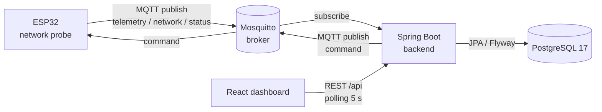
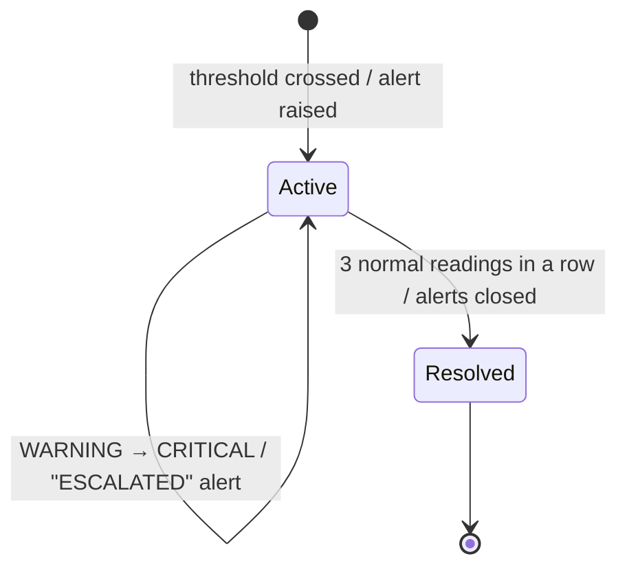
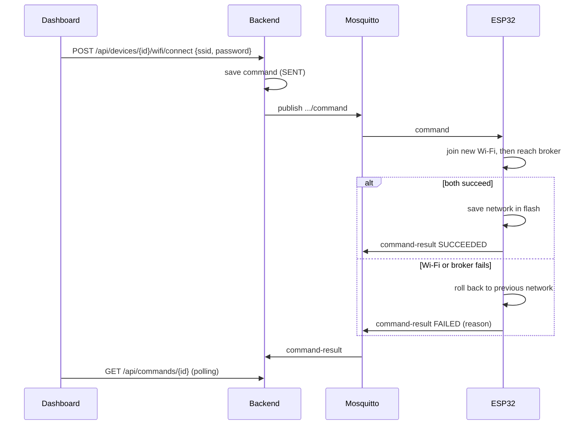

# NetPulse

**IoT network monitoring and anomaly detection platform.**

An ESP32 continuously measures the real quality of a network (Wi-Fi signal, latency, packet loss) and its own health, and publishes them over MQTT. A Spring Boot backend stores the measurements in PostgreSQL, detects degradations with a rule engine, raises alerts, and serves a React dashboard. From that dashboard you can also scan nearby Wi-Fi networks and move the ESP32 to another network, without touching the code.

     

---

## Table of contents

1. [The problem](#the-problem)
2. [Features](#features)
3. [Architecture](#architecture)
4. [Tech stack](#tech-stack)
5. [Repository structure](#repository-structure)
6. [Getting started](#getting-started)
7. [Configuration](#configuration)
8. [How it works](#how-it-works)
9. [MQTT contract](#mqtt-contract)
10. [REST API](#rest-api)
11. [Testing](#testing)
12. [Demo scenario](#demo-scenario)
13. [Security notes](#security-notes)
14. [Roadmap](#roadmap)

---

## The problem

Network problems usually build up silently: the Wi-Fi signal weakens, latency rises, packets get lost, a device disconnects. Nobody notices until users complain, and by then nobody knows **when** it started or **where** the problem is.

NetPulse is a permanent probe inside the network that:

- **measures** network quality where the devices actually are;
- **detects** degradations automatically, without anyone watching charts;
- **locates** the problem: weak Wi-Fi, local network (gateway) or internet provider;
- **keeps a history**: when it started, how long it lasted, whether it comes back.

> Example from a real run: the gateway answered in ~5 ms with 0 % loss, while the internet showed ~15 % packet loss and ~450 ms latency. NetPulse showed the problem was the internet connection, not the local Wi-Fi.

## Features

| Area | What NetPulse does |
|---|---|
| **Measurement** (ESP32) | Wi-Fi RSSI, gateway ping (10 packets), internet ping (5 packets), free heap, uptime, weighted network health score (0–100) |
| **Ingestion** | MQTT consumer with automatic reconnect and resubscription; devices register themselves on their first message |
| **Storage** | PostgreSQL with Flyway migrations; nightly purge of raw readings older than 7 days |
| **Anomaly detection** | 8 threshold rules (warning / critical), anomaly *episodes* with escalation and automatic resolution |
| **Alerts** | Raised when an anomaly opens or escalates, closed automatically when it resolves; acknowledge / resolve from the UI |
| **Device status** | ONLINE / OFFLINE from the MQTT last will and a 30 s silence timeout |
| **Remote Wi-Fi management** | Scan nearby networks from the dashboard and move the ESP32 to one of them, with automatic rollback |
| **Dashboard** | Overview, Devices, Telemetry charts, Anomalies, Alerts, Wi-Fi; refreshes every 5 s |

## Architecture



The backend is a **modular monolith**: one deployable application split into business modules.

| Module | Responsibility |
|---|---|
| `device` | Device registration, ONLINE/OFFLINE status, silent-device detection |
| `telemetry` | MQTT consumer, storage of readings, history queries, retention job |
| `anomaly` | Rule engine (`AnomalyDetector`) and anomaly episodes |
| `alert` | Alert lifecycle (open, acknowledged, resolved) |
| `command` | Remote commands to devices (Wi-Fi scan, Wi-Fi switch) |
| `overview` | Aggregated numbers for the dashboard home page |
| `common`, `config` | Error handling (RFC 9457), MQTT client, CORS, clock |

## Tech stack

| Layer | Technology |
|---|---|
| Firmware | ESP32 · Arduino framework · PlatformIO · PubSubClient · ESP32Ping · ArduinoJson 7 |
| Messaging | MQTT 3.1.1 · Eclipse Mosquitto 2 (Docker) |
| Backend | Java 21 · Spring Boot 4.1 · Spring Data JPA · Hibernate 7 · Flyway · Eclipse Paho · Jackson 3 |
| Database | PostgreSQL 17 (Docker) · H2 for tests |
| Frontend | React 19 · TypeScript · Vite 6 · Tailwind CSS 4 · Recharts · React Router 7 |
| Tests | JUnit 5 · AssertJ · MockMvc · Mockito |

## Repository structure

```text
netpulse/
├── firmware/esp32/              ESP32 firmware (PlatformIO)
│   ├── src/main.cpp             measurements, health score, MQTT, remote commands
│   └── include/secrets.example.h  template for the default Wi-Fi
├── netpulse-backend/            Spring Boot backend
│   ├── src/main/java/com/netpulse/backend/
│   │   ├── device/  telemetry/  anomaly/  alert/  command/  overview/
│   │   └── common/  config/
│   ├── src/main/resources/
│   │   ├── application.properties
│   │   └── db/migration/        Flyway SQL migrations
│   └── src/test/                unit and integration tests
├── frontend/                    React dashboard
│   └── src/{api,components,hooks,pages,lib}
├── mqqt/                        Mosquitto (docker-compose.yml + config)
├── docker-compose.yml           PostgreSQL
├── infrastructure/  jenkins/    DevOps (in progress)
└── docs/                        architecture, UML, installation
```

## Getting started

### Prerequisites

| Tool | Version |
|---|---|
| Docker + Docker Compose | Compose v2 |
| JDK | 21 |
| Maven | 3.8+ |
| Node.js | 20+ |
| PlatformIO | CLI or VS Code extension |
| Hardware | ESP32 dev board (2.4 GHz Wi-Fi) |

### 1. Start the infrastructure

```bash
docker compose up -d                              # PostgreSQL on localhost:5432
docker compose -f mqqt/docker-compose.yml up -d   # Mosquitto on port 1883
docker compose ps                                 # netpulse-postgres must be "healthy"
```

### 2. Start the backend → http://localhost:7000

```bash
cd netpulse-backend
export JAVA_HOME=/usr/lib/jvm/java-21-openjdk-amd64   # Maven must run on JDK 21
mvn spring-boot:run
```

Flyway creates the tables on first start. Expected log lines:
`[MQTT] Connected to tcp://...` then `[MQTT] All subscriptions initialized!`

### 3. Start the dashboard → http://localhost:5173

```bash
cd frontend
npm install
npm run dev
```

In development, Vite proxies `/api` to the backend on port 7000.

### 4. Flash the ESP32

```bash
cd firmware/esp32
cp include/secrets.example.h include/secrets.h   # then set your default Wi-Fi and broker
```

In `include/secrets.h` (git-ignored), set:

- `WIFI_SSID` / `WIFI_PASSWORD`: the default 2.4 GHz network;
- `MQTT_BROKER_HOST`: the machine running Mosquitto, as `<hostname>.local` (run `hostname` on it).

The ESP32 resolves the `.local` name with mDNS on every connection, so nothing changes when the PC gets a new IP or moves to another network, as long as the ESP32 and the PC are on the same network. Linux advertises the name through `avahi-daemon`, macOS natively, and Windows 10+ for most setups. A plain IP also works but must be updated when it changes.

Then:

```bash
pio run -t upload       # build and flash over USB
pio device monitor      # serial logs at 115200 baud
```

The device appears in the dashboard on its first message: there is nothing to create in the database.

## Configuration

### Backend environment variables

| Variable | Default | Purpose |
|---|---|---|
| `DB_URL` | `jdbc:postgresql://localhost:5432/netpulse` | Database URL |
| `DB_USERNAME` / `DB_PASSWORD` | `netpulse_user` / `netpulse_password` | Database credentials |
| `MQTT_BROKER_URL` | `tcp://localhost:1883` | Broker; change it only when Mosquitto runs on another machine |
| `CORS_ALLOWED_ORIGINS` | `http://localhost:5173` | Origins allowed to call the API |

### Application settings (`netpulse-backend/src/main/resources/application.properties`)

| Property | Default | Meaning |
|---|---|---|
| `netpulse.device.offline-timeout` | `30s` | Silence after which a device is OFFLINE |
| `netpulse.telemetry.retention` | `7d` | Age of readings purged every night at 03:00 |
| `netpulse.command.timeout` | `120s` | Unanswered commands become TIMED_OUT |
| `netpulse.anomaly.*` | see below | Detection thresholds |
| `netpulse.anomaly.resolve-after` | `3` | Normal readings in a row needed to resolve an anomaly |

## How it works

### 1. Measurement on the ESP32

Every cycle (about 10 s including pings), the ESP32 reads the RSSI, pings the gateway 10 times and the internet 5 times, reads its free heap and uptime, then computes a **health score**:

| Component | Weight |
|---|---|
| Wi-Fi signal | 20 % |
| Gateway packet loss | 25 % |
| Gateway latency | 15 % |
| Internet packet loss | 25 % |
| Internet latency | 15 % |

Score → status: **EXCELLENT** ≥ 90 · **GOOD** ≥ 75 · **FAIR** ≥ 60 · **POOR** ≥ 40 · **CRITICAL** < 40. A metric that cannot be measured is sent as `null` and excluded from the score.

### 2. Ingestion

For every MQTT message the backend:

1. identifies the device from the topic and registers it if new;
2. marks it ONLINE and updates `last_seen`;
3. stores the reading;
4. runs the rule engine on the values;
5. opens, updates or resolves anomalies and alerts.

### 3. Anomaly detection

| Anomaly | Warning | Critical |
|---|---|---|
| Weak Wi-Fi signal | RSSI < -80 dBm | < -90 dBm |
| High gateway latency | > 100 ms | > 300 ms |
| High internet latency | > 300 ms | > 1000 ms |
| Packet loss (gateway / internet) | > 10 % | > 50 % |
| Degraded network health | score < 60 | < 40 |
| Low memory | free heap < 20 000 B | < 10 000 B |
| Device offline | — | no data for 30 s, or MQTT last will |

An anomaly is an **episode**, not one row per reading:



- **No alert storm**: one hour of weak signal is one anomaly and one alert, not 360.
- **No flapping**: a value oscillating around the threshold does not open and close episodes in a loop.
- **No false zero**: an unmeasured value (`null`) neither opens nor resolves anything.

### 4. Offline detection

- **MQTT last will**: if the ESP32 disappears, the broker publishes `offline` on its behalf.
- **Silence timeout**: no data for 30 s marks the device OFFLINE, which covers cases where the last will is not delivered.
- **Startup grace period**: after a backend restart, devices get 30 s to report before being judged.

### 5. Remote Wi-Fi management

From the **Wi-Fi** page: *Scan networks* → pick a network → type its password → *Connect the ESP32*.



- The ESP32 keeps the new network **only if it can join it and reach the broker from it**. Otherwise it goes back by itself, so it never becomes unreachable.
- The chosen network survives reboots. `secrets.h` is only the default, used on first boot and as a fallback.
- One command at a time per device; offline devices reject commands (HTTP 409).
- The ESP32 only sees **2.4 GHz** networks.

## MQTT contract

| Topic | Direction | Payload |
|---|---|---|
| `netpulse/devices/{id}/telemetry` | device → backend | `deviceId, uptime, freeHeap, totalHeap, heapUsage, flashSizeMB, ssid, ip, rssi` |
| `netpulse/devices/{id}/network` | device → backend | `deviceId, rssi, gatewayLatency, gatewayPacketLoss, internetLatency, internetPacketLoss, networkHealthScore, networkStatus` (`null` when not measurable) |
| `netpulse/devices/{id}/status` | device → backend | `online` · `switching` (changing Wi-Fi) · `offline` (last will, retained) |
| `netpulse/devices/{id}/command` | backend → device | `{"id","action":"scan"}` or `{"id","action":"connect_wifi","ssid","password"}` |
| `netpulse/devices/{id}/command-result` | device → backend | `{"requestId","action","status":"SUCCEEDED"/"FAILED","message","ssid","ip","networks":[...]}` |

Example `network` message:

```json
{
  "deviceId": "esp32-01",
  "rssi": -72.0,
  "gatewayLatency": 6.6,
  "gatewayPacketLoss": 0.0,
  "internetLatency": 132.67,
  "internetPacketLoss": 20.0,
  "networkHealthScore": 49.5,
  "networkStatus": "POOR"
}
```

## REST API

Base URL: `http://localhost:7000/api`

| Method | Path | Description |
|---|---|---|
| GET | `/overview` | Device counts, active anomalies, unresolved alerts, 5 latest alerts |
| GET | `/devices` | Devices with their latest network reading |
| GET | `/devices/{id}` | One device |
| GET | `/devices/{id}/telemetry?minutes=60` | System telemetry history, oldest first |
| GET | `/devices/{id}/network?minutes=60` | Network metrics history, oldest first |
| GET | `/anomalies?status=ACTIVE&device={id}` | Anomalies, newest first |
| GET | `/alerts?status=OPEN` | Alerts, newest first |
| POST | `/alerts/{id}/acknowledge` | Acknowledge an alert |
| POST | `/alerts/{id}/resolve` | Close an alert manually |
| POST | `/devices/{id}/wifi/scan` | Ask the device to scan Wi-Fi networks (202, asynchronous) |
| POST | `/devices/{id}/wifi/connect` | `{"ssid","password"}`: move the device to another Wi-Fi (202, asynchronous) |
| GET | `/commands/{commandId}` | Command status (`SENT` → `SUCCEEDED` / `FAILED` / `TIMED_OUT`) and scan results |
| GET | `/devices/{id}/commands` | Latest commands sent to a device |

Errors use RFC 9457 problem details:

```json
{ "status": 404, "title": "Not Found", "detail": "Device not found: esp32-99" }
```

## Testing

### Automated tests

```bash
cd netpulse-backend && mvn test    # 23 tests, H2 in-memory: no Docker, broker or ESP32 needed
cd frontend && npm run build       # TypeScript type-check + production build
```

| Test class | Covers |
|---|---|
| `AnomalyDetectorTest` | Every threshold rule, warning vs critical, `null` values skipped |
| `TelemetryFlowIntegrationTest` | MQTT payload → database → anomaly → alert → REST, escalation, resolution, offline / back online |
| `WifiCommandIntegrationTest` | Scan and connect round trips, validation, one command at a time, password never returned |
| `DeviceStatusMonitorTest` | Startup grace period |

### Manual end-to-end checks

| Step | Command | Expected |
|---|---|---|
| ESP32 → broker | `docker exec netpulse-mosquitto mosquitto_sub -t 'netpulse/#' -v` | A JSON message every ~10 s |
| Backend → DB | `docker exec netpulse-postgres psql -U netpulse_user -d netpulse -c "select count(*) from network_metrics;"` | Count increases |
| API | `curl localhost:7000/api/overview` | `totalDevices: 1` |

### Without an ESP32

Publish the messages yourself (use a separate device id):

```bash
# Critical signal and packet loss → CRITICAL anomalies
docker exec netpulse-mosquitto mosquitto_pub -t netpulse/devices/esp32-sim/network -m \
'{"deviceId":"esp32-sim","rssi":-92,"gatewayLatency":350,"gatewayPacketLoss":60,"internetLatency":null,"internetPacketLoss":100,"networkHealthScore":20,"networkStatus":"CRITICAL"}'

# Simulated disconnection
docker exec netpulse-mosquitto mosquitto_pub -t netpulse/devices/esp32-sim/status -m offline

# Clean up (cascades to readings, anomalies, alerts)
docker exec netpulse-postgres psql -U netpulse_user -d netpulse -c "delete from devices where device_code='esp32-sim';"
```

## Demo scenario

1. Start the infrastructure, backend and dashboard; power on the ESP32: it appears **Online**.
2. Open **Telemetry**: charts fill in, with thresholds drawn as dashed lines.
3. Move the ESP32 away from the router: a **Weak Wi-Fi signal** anomaly and alert appear.
4. Bring it back: after 3 normal readings the anomaly is **Resolved** and its alert closes.
5. Unplug the ESP32: it goes **Offline** with a CRITICAL anomaly; plug it back and it recovers by itself.
6. Open **Wi-Fi**: scan networks and switch to another one; try a wrong password to show the automatic rollback.

## Security notes

- Wi-Fi passwords travel inside the MQTT command but are **never stored** in the database nor written to logs.
- Mosquitto currently accepts **anonymous, unencrypted** connections. That is fine on a lab network, but authentication and TLS must be enabled before any other use.
- Only connect the ESP32 to networks you are allowed to use.
- `firmware/esp32/include/secrets.h` is git-ignored; commit only `secrets.example.h`.

## Roadmap

- [x] ESP32 network probe and MQTT publishing
- [x] Spring Boot ingestion, PostgreSQL persistence, Flyway migrations
- [x] Rule-based anomaly detection and alerting
- [x] React dashboard
- [x] Remote Wi-Fi scan and switch with rollback
- [ ] Broker address configurable from the dashboard (switch to Wi-Fi networks on another LAN)
- [ ] Dockerfiles and a complete Docker Compose stack
- [ ] Jenkins CI/CD pipeline
- [ ] Prometheus + Grafana supervision (Spring Boot Actuator / Micrometer)
- [ ] MQTT authentication and TLS
- [ ] AI diagnosis of anomalies (Spring AI + Ollama)
